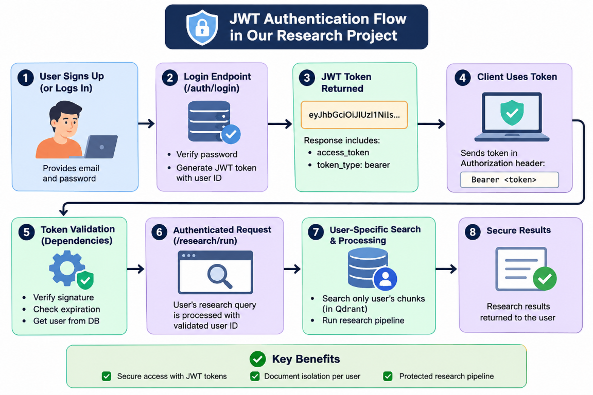
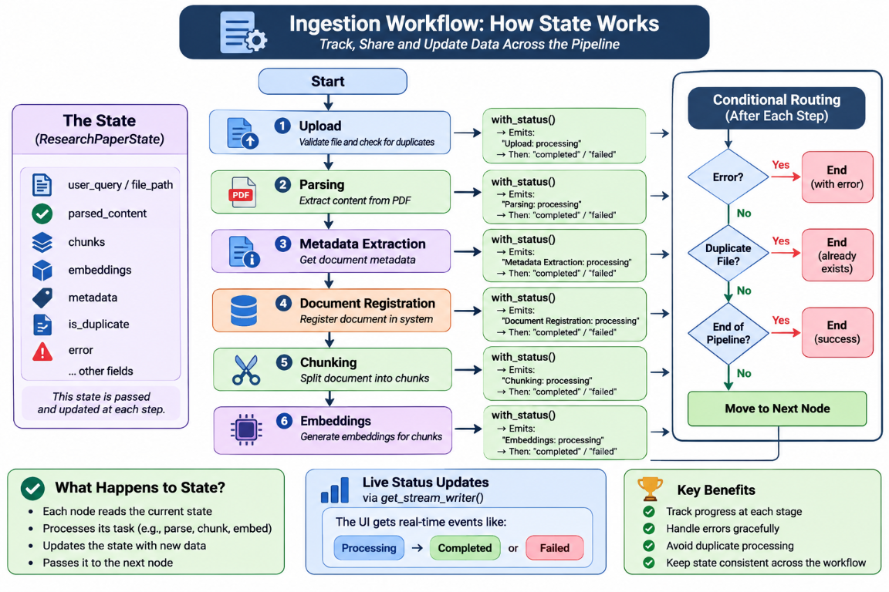
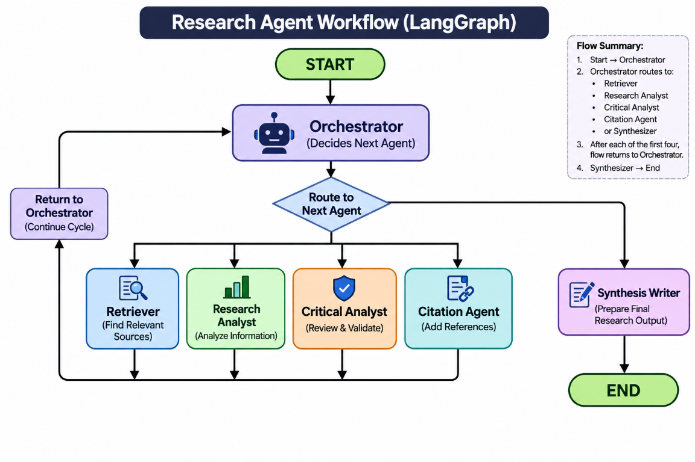
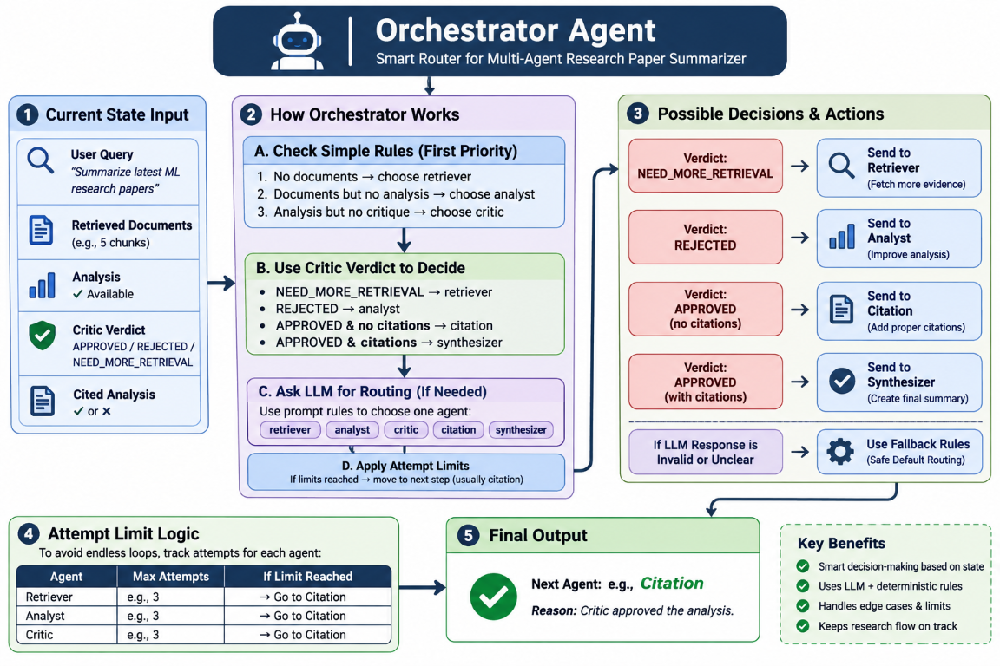

# Multi-Agent AI Research Paper Summarizer

A full-stack research assistant for ingesting academic documents, retrieving user-scoped evidence from indexed paper chunks, and generating evidence-grounded answers through a LangGraph multi-agent workflow.

This project combines:
- a FastAPI backend for authentication, ingestion, research execution, and evaluation
- a Gradio front-end for document upload, research questions, and dashboards
- MongoDB for user and document metadata
- Qdrant for dense+sparse vector retrieval
- LangGraph agents for orchestration, retrieval, critique, citation, and synthesis
- DeepEval for retriever and generator benchmarking

## Overview

The application is designed to help a user work with a personal library of research papers. A user uploads one or more papers, the system parses and chunks them, embeds the chunks into a vector store, and later answers research questions over only that user’s data.

The core research flow is:
1. Upload a document
2. Validate and parse it into Markdown
3. Chunk the text while preserving section structure
4. Generate dense and sparse embeddings and index them in Qdrant
5. Run hybrid retrieval (dense + sparse + reranking)
6. Orchestrate a multi-agent pipeline to analyze, critique, cite, and synthesize an answer
7. Evaluate retrieval and generation quality with DeepEval

## Key Features

- User authentication with JWT-based access tokens
- Personal document ownership filtering across all research queries
- Versioned paper management for repeated uploads and updates
- LangGraph ingestion pipeline for upload → parse → chunk → embed
- Hybrid search combining dense semantic retrieval, sparse BM25, RRF fusion, and cross-encoder reranking
- Multi-agent research workflow with:
  - Orchestrator
  - Retriever
  - Research Analyst
  - Critical Analyst
  - Citation Agent
  - Synthesis Writer
- Streaming progress updates in the UI and API
- Built-in retriever, generator, and RAG evaluation routes
- Gradio dashboard for end-user interaction

## Architecture

The project is organized around a few clear layers:

- Frontend: `main.py` — Gradio UI and page navigation
- API: `api_main.py` and the modules under `api/` — FastAPI routes and SSE endpoints
- Orchestration: `graphs/` and `agents/` — LangGraph workflow and agent logic
- Services: `services/` — document upload, parsing, chunking, embeddings, search, auth client
- Persistence:
  - MongoDB: user accounts and document version metadata
  - Qdrant: indexed research chunks and metadata filters
- Evaluation: `evals/` and `goldens/` — benchmark pipelines and golden datasets

## Project Structure

```text
Multi_Agent_AI_Research_Paper_Summarizer/
├── agents/                       # LangGraph research agents
│   ├── analyst_agent.py
│   ├── citation_agent.py
│   ├── critic_agent.py
│   ├── orchestrator_agent.py
│   ├── retriever_agent.py
│   └── synthesizer_agent.py
├── api/                         # FastAPI routers
│   ├── auth.py
│   ├── auth_utils.py
│   ├── generator_eval.py
│   ├── ingestion.py
│   ├── ingestion_service.py
│   ├── papers.py
│   ├── rag_pipeline_evaluation.py
│   ├── research.py
│   ├── research_service.py
│   ├── retriever_eval.py
│   └── __init__.py
├── database/                    # MongoDB access and user models
│   ├── database.py
│   ├── models.py
│   ├── schemas.py
│   └── session.py
├── evals/                       # DeepEval evaluation pipelines
│   ├── eval_generator.py
│   ├── eval_rag_pipeline.py
│   ├── eval_retriever.py
│   ├── generator_eval_graph.py
│   ├── harness.py
│   └── __init__.py
├── goldens/                     # Generated golden datasets
├── graphs/                      # LangGraph workflow definitions
│   ├── ingestion_graphs.py
│   └── research_graphs.py
├── llm/                         # LLM configuration
│   └── llm.py
├── nodes/                       # Ingestion graph nodes
│   ├── chunking_node.py
│   ├── document_registration_node.py
│   ├── embedding_node.py
│   ├── metadata_node.py
│   ├── parser_node.py
│   ├── upload_node.py
│   └── __init__.py
├── parsed_papers/               # Parsed Markdown output files
├── services/                    # Search, parsing, auth, document services
│   ├── auth_client.py
│   ├── bm25_service.py
│   ├── chunking_service.py
│   ├── document_management_service.py
│   ├── embedding_service.py
│   ├── gradio_auth.py
│   ├── hybrid_search_service.py
│   ├── paper_metadata_service.py
│   ├── parser_service.py
│   ├── pdf_service.py
│   └── __init__.py
├── src/                         # Utility pipeline wrapper
│   └── rag_pipeline.py
├── state/                       # Typed state definitions for LangGraph
│   └── state.py
├── data/                        # Uploaded papers and generated artifacts
├── chunks/                      # Chunk JSON outputs by user ID
├── graphs_output/               # Graph visualization PNG files
├── test/                        # Test scripts and pipeline checks
├── .env                         # Local environment configuration (not committed)
├── api_main.py                  # FastAPI application entrypoint
├── config.py                    # Global config constants
├── main.py                      # Gradio application entrypoint
├── requirements.txt             # Python dependencies
├── LICENSE
├── README.md
└── .gitignore
```

## Tech Stack

- Python 3.11+
- FastAPI
- Gradio
- LangChain / LangGraph
- Groq + LangChain Groq integration
- Ollama embeddings and LLM usage
- Qdrant
- MongoDB
- Docling / PyMuPDF / Markdown parsing pipeline
- DeepEval
- Pydantic, Python JWT, Passlib

## Requirements

Before running the project, make sure you have:

- a MongoDB instance running locally or remotely
- a Qdrant collection configured and accessible
- a Groq API key for the LLM used in `llm/llm.py`
- Python dependencies installed

## Environment Variables

Create a `.env` file in the project root with values similar to:

```env
JWT_SECRET_KEY=your-secret-key
JWT_ALGORITHM=HS256
ACCESS_TOKEN_EXPIRE_MINUTES=60

MONGO_URL=mongodb://localhost:27017
MONGODB_URI=mongodb://localhost:27017
MONGODB_DATABASE=research_paper_summarizer
MONGODB_DOCUMENTS_COLLECTION=documents
MONGODB_VERSIONS_COLLECTION=document_versions

QDRANT_URL=https://your-qdrant-instance
QDRANT_API_KEY=your-qdrant-key
QDRANT_COLLECTION=research_papers

GROQ_API_KEY=your-groq-key
```

Notes:
- `database/database.py` uses `MONGO_URL` for the auth DB connection
- `services/document_management_service.py` reads `MONGODB_URI` for document version tracking
- `config.py` reads `QDRANT_URL`, `QDRANT_API_KEY`, and `QDRANT_COLLECTION`
- `llm/llm.py` uses `ChatGroq`, so the Groq API key must be available in the environment

## Installation

```bash
cd "C:\Users\Pappu Yadav\Desktop\cp\Multi_Agent_AI_Research_Paper_Summarizer"
python -m venv .venv
.\.venv\Scripts\activate
pip install -r requirements.txt
```

If you are using the project’s bundled environment in this workspace, it may already exist under `m_env/` and can be activated with:

```bash
m_env\Scripts\activate
```

## Running the Application

Start the API backend first:

```bash
uvicorn api_main:app --host 0.0.0.0 --port 8001 --reload
```

Then launch the Gradio app:

```bash
python main.py
```

The UI will connect to the backend at `http://127.0.0.1:8001` and the Gradio interface will launch on the default Gradio port (typically `http://localhost:7860`).

## How It Works

### 1. Authentication

The app supports signup and login via FastAPI routes in `api/auth.py` and `api/auth_utils.py`.

- New users are created in MongoDB
- Passwords are hashed with `pwdlib`
- Login returns a JWT access token
- Protected routes use `Depends(get_current_user)`



### 2. Document Ingestion Pipeline



The ingestion workflow in `graphs/ingestion_graphs.py` runs these nodes:

- `upload`
- `parser`
- `metadata`
- `document_registration`
- `chunking`
- `embedding`

Files are validated, saved, parsed to Markdown, chunked while preserving section context, and indexed into Qdrant. The app also prevents duplicate exact uploads using SHA-256 hashing and document version records.

### 3. Hybrid Retrieval

The retriever uses `services/hybrid_search_service.py` to perform:

- dense embedding search against Qdrant
- sparse lexical search using BM25-style embeddings
- reciprocal rank fusion (RRF)
- cross-encoder reranking for final ordering

All results are filtered to the authenticated user’s documents and paper versions.

### 4. Multi-Agent Research Workflow





The research graph in `graphs/research_graphs.py` orchestrates these agents:

- `orchestrator` decides the next node
- `retriever` fetches relevant chunks from that user’s library
- `analyst` writes an evidence-grounded answer
- `critic` verifies claims and requests corrections when needed
- `citation` attaches source references
- `synthesizer` produces the final response

The workflow loops until the answer is approved or retries are exhausted.

### 5. Evaluation

The project includes built-in evaluation routes for:

- retriever evaluation
- generator evaluation
- full RAG pipeline evaluation

These use `deepeval` and golden datasets generated under `goldens/`.

## API Endpoints

The FastAPI app exposes the following main routes:

- `POST /auth/signup` — user registration
- `POST /auth/login` — user login and JWT issuance
- `POST /ingestion/upload` — upload a document and stream pipeline events
- `GET /papers/uploaded` — list uploaded papers and versions
- `POST /research/run` — run the multi-agent research pipeline
- `POST /evaluation/retriever` — evaluate hybrid retrieval
- `POST /evaluation/generator/generate-goldens` — generate faithfulness goldens
- `POST /evaluation/generator` — run generator evaluation
- `POST /evaluation/rag` — run end-to-end RAG evaluation

## Typical Usage

1. Start MongoDB and Qdrant
2. Add required environment variables in `.env`
3. Start the FastAPI backend
4. Start the Gradio UI
5. Create an account
6. Upload a research paper
7. Wait for parsing, chunking, and embedding
8. Ask a research question in the multi-agent workspace
9. Review citations, analysis, and final answer
10. Run evaluation pages to benchmark retrieval and answer quality

## Output Artifacts

The project writes generated artifacts to local folders such as:

- `data/uploaded_papers/` — saved uploaded docs
- `parsed_papers/` — Markdown extraction output
- `chunks/` — chunk JSON files by user ID
- `graphs_output/` — graph visuals saved as PNG files
- `goldens/` — golden dataset artifacts

## Notes

- The app is user-scoped: retrieval and document listing are filtered by the authenticated user ID.
- The project expects a working Qdrant collection already configured for the document embeddings.
- The ingestion and research pipelines stream progress through Server-Sent Events (SSE) so the UI can update in real time.
- The repo contains a bundled Python environment under `m_env/`, but the project should still be configured via a normal virtual environment when needed.

## License

This project is licensed under the terms in the [LICENSE](LICENSE) file.
